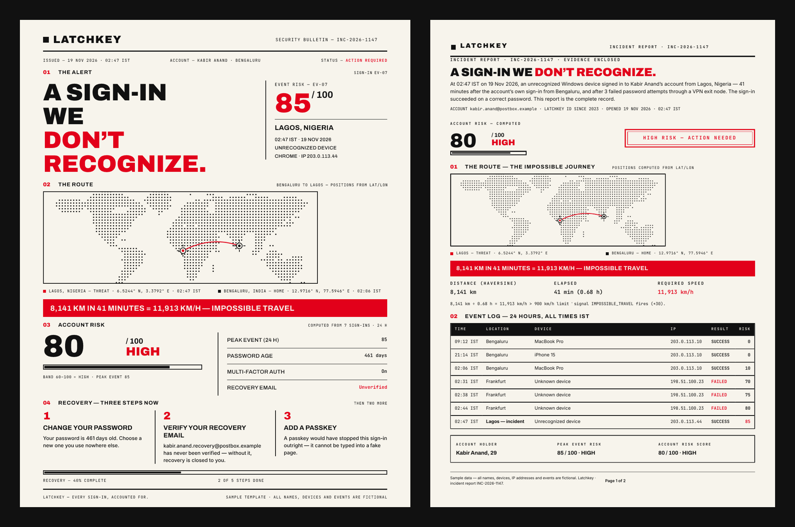
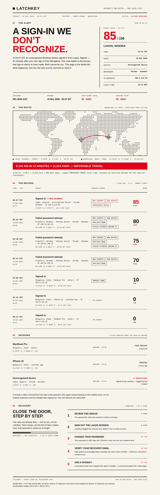

# Latchkey — The Account Security Kit

**Every sign-in, accounted for.** A complete account-security communications kit —
suspicious sign-in alert, security center, incident report, and recovery card —
designed as a Swiss security bulletin: warm off-white paper, ink black, one
pure red, and a flat dot-matrix route map that traces the impossible sign-in.
Precise, print-confident, and honest about its own arithmetic.



**Live demo:** https://latchkey-account-security-kit.vercel.app/

## The story

Security email is the most feared mail in any inbox — and usually the ugliest.
Latchkey is the kit a security team would be proud to send. One fictional
account (Kabir Anand, Bengaluru) has a bad night: at 02:47 IST a sign-in
succeeds from an unrecognized Windows device in **Lagos, Nigeria** — 41 minutes
after his own sign-in from Bengaluru, and after three failed password attempts
from a VPN exit node in Frankfurt. The kit is the response, in four formats.

## One record in, everything computed out

All four templates render from a single account record in `src/data.ts`.
Nothing about the risk is typed in by hand:

- **Signal weights** live in code: new country +35, new device +20,
  VPN exit node +15, unusual hour +10, failed attempts +5 each (capped).
- **Impossible travel is genuinely detected** — consecutive sign-ins are
  checked with a haversine distance ÷ time calculation. Bengaluru → Lagos is
  **8,141 km in 41 minutes = 11,913 km/h**, so the incident event scores
  **85 (HIGH)**.
- **The account score (80, HIGH)** blends the peak event with account factors:
  password age 461 days (+5), MFA on (−10). The recovery-email credit (−5)
  deliberately does *not* fire — his recovery email was never verified — and
  the checklist picks that up as a recovery step.
- Verdict bands, session states (current / trusted / suspicious), and the
  recovery checklist progress (2 of 5 = 40%) are all derived the same way.

Change a city, an hour, or a device in `src/data.ts` and every output
re-derives itself.

## The four templates

| Root | Output | What it is |
|---|---|---|
| `Email` (600px) | `out/security-alert.html` | Suspicious sign-in alert — the bulletin in tables: masthead, huge headline, ruled event record with a flat segmented meter, red verdict band, stamp, "No — secure my account" / "Yes, it was me" |
| `Page` (1120px) | `out/security-center.html` | Security center — five numbered sections: the alert, the flat route map with the red Bengaluru → Lagos arc, the sign-in record as ruled rows with big risk numerals, sessions, recovery protocol |
| `Document` (A4, 2 pages) | `out/incident-report.pdf` | Incident report INC-2026-1147 — flat route map and verdict on page 1; event log, travel computation, and "the arithmetic, in full": every signal, weight, and point behind the score |
| `Canvas` (1080×1350) | `out/recovery-card.png` | Recovery card — the bulletin as a poster: the route map, the giant 80, ruled factor rows, the next three steps, computed progress |



## How Hyper Elements is used

- All four roots — `Email`, `Page`, `Document`, `Canvas` — from one
  `defineTheme()` and a shared component library (■ wordmark, flat
  dot-matrix route map with city positions computed from real lat/lon,
  outlined meter, ruled factor rows, verdict stamp, signal tags, mono
  data labels). The Email uses an Svg-free variant of the art, since Svg
  isn't available in email.
- `validate()` gates the build; the Document renders via `renderPdf()` and
  the Canvas via `renderImage()`, with real Archivo / Inter /
  JetBrains Mono font files passed as bytes.
- The email was checked with `@hyper-elements/email-clients`: **7 client
  previews** (Outlook, Outlook.com, Gmail, Apple Mail, iPhone) are generated
  by the build into `out/email-clients/`.

**Validation: 0 errors, 0 warnings on all four templates** (the email carries
23 informational notes — classic Outlook letter-spacing, button-hover and
phone-style notes — nothing broken, as the previews show).

## Run it

```bash
npm install
npm run build   # validates, then renders everything into out/
npm run check   # validate only
```

## Design

A Swiss security bulletin — a bank notice meets an Interpol bulletin meets
an aviation safety card. Warm off-white paper (`#F7F4EC`), ink black
(`#111111`), and ONE pure red (`#E2001A`) for threat, verdicts and HIGH —
no other hues; lower bands are black typographic treatments, because risk
here is communicated by numerals, rules and red. Flat everything: square
corners, no shadows, no gradients, hard black rules dividing numbered
sections. The centerpiece is a flat dot-matrix route map generated in code
from an embedded landmass grid — Bengaluru, Lagos and Frankfurt are placed
by projecting their real coordinates, and the solid red arc between home
and threat *is* the incident. Archivo 900 for the huge headlines and
numerals, Inter for prose, JetBrains Mono only for small data labels —
because in a bulletin, the data *is* the design.

---

Latchkey is fictional. All names, devices, IP addresses and events in this
template are invented sample data; IP addresses use the documentation ranges
(203.0.113.0/24, 198.51.100.0/24). Fonts: Archivo, Inter, JetBrains
Mono (SIL OFL, via Fontsource).
